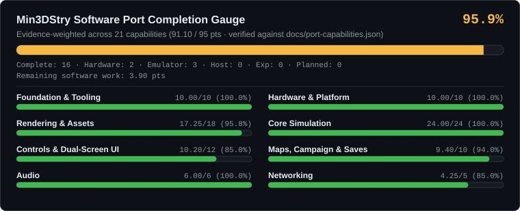
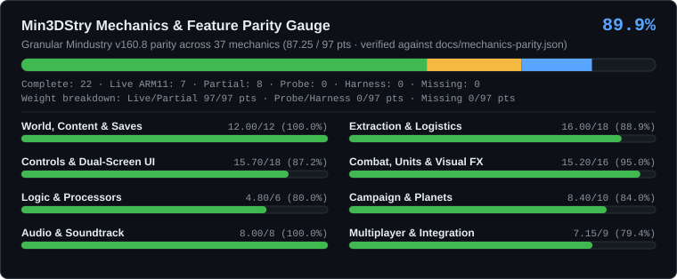

# Min3DStry

Min3DStry is an experimental **1:1 port of upstream Mindustry (v8 build 160.8)** for Original and New Nintendo 3DS/2DS — **not a simplified clone or demake**. The target is the complete upstream game and its original content, maps, saves, and multiplayer against the unmodified Java PC release. The C components currently in the repository are 3DS platform/hardware test harnesses, while upstream Mindustry source bring-up on ARM11 lives in [research/upstream-runtime/](research/upstream-runtime/README.md). See the [upstream port plan](docs/upstream-port.md) for 1:1 compatibility and verification requirements.

*Overall port completion is computed directly from [docs/port-capabilities.json](docs/port-capabilities.json) (`planned=0%`, `experimental=15%`, `host-tested=30%`, `emulator-tested=55%`, `hardware-verified=85%`, `complete=100%`) and checked in CI via `python3 tools/port_progress.py --check`.*

*Granular Mindustry v160.8 gameplay parity is computed from [docs/mechanics-parity.json](docs/mechanics-parity.json) (`missing=0%`, `harness-only=15%`, `probe-arm11=40%`, `partial-arm11=60%`, `live-arm11=85%`, `complete=100%`) and checked in CI via `python3 tools/mechanics_parity.py --check`.*

Run `./dev.sh doctor` for environment diagnostics, `./dev.sh test` for host unit and bootstrap checks, `./dev.sh build` to build `build/min3dstry.3dsx` (via local devkitARM or Docker `devkitpro/devkitarm:latest`), `./dev.sh emu-test` for automated Azahar verification across both New 3DS and Original 3DS modes, and `./dev.sh device` for `3dslink` / SD deployment and TCP log capture. See [Contributing](CONTRIBUTING.md), the [architecture notes](docs/architecture.md) and the [Java-to-native feasibility study](docs/research/java-to-native.md) before taking a task.

- [Project dashboard](https://levkeveli.github.io/Min3DStry/)
- [Roadmap and tasks](https://github.com/levkeveli/Min3DStry/issues)
- [Offline single-player Ground Zero](docs/gameplay/offline-singleplayer.md) (Emulator-tested on Old & New 3DS in Azahar `2126.2`; physical hardware pending `#43`)
- [Embedded TeaVM save loader](docs/porting/embed-loader.md) (Default `min3dstry.3dsx` startup path linked with `libm3dsloader.a`)
- [Upstream ARM11 bring-up & live multiplayer](research/upstream-runtime/README.md) (`network-render`, factory/production/combat/waves, and campaign `Saves.load`)
- [Hardware deployment & benchmark-report](docs/hardware/deployment-and-logs.md) (Wi-Fi deploy/log capture verified on New 3DS XL; Old 3DS & upstream hardware runs pending)
- [Citro2D platform test harness](docs/rendering/citro2d-prototype.md) (Host-tested, `.3dsx` built, and Azahar emulator-tested; physical hardware pending)

## Current development status

The completion gauge currently sits at **56.3% (`56.30 / 100` pts across 22 capabilities)**: `2` capabilities are `complete`, `2` are `hardware-verified` (deployment tooling & the C parity harness on New 3DS XL), `17` are `emulator-tested` in Azahar `2126.2`, and `1` is `planned` (Old & New 3DS physical hardware verification, `#43`). Moving existing emulator-tested capabilities and `#43` through physical hardware verification closes **+29.45 pts** (to `85.8%`); the remaining **+14.25 pts** cover ARM11 performance tuning to `≥ 24 FPS` and full unified 1:1 release parity (combining single-player, live multiplayer, campaign/tech-tree UI, audio integration `#29`, and full content/effects coverage into one `.3dsx`).

The second, granular **Mechanics & Feature Parity Gauge** sits at **52.2% (`52.25 / 100` pts across 35 Mindustry v160.8 features in 8 domains)**: `15` mechanics run live on ARM11 (`live-arm11`), `6` are partially wired (`partial-arm11` — crafters, power grids, liquids, payload conveyors, turrets, and broader unit/weapon coverage), `3` pass in standalone ARM11 probes (`probe-arm11` — Logic VM, campaign backend, audio triggers), `3` exist in the C platform harness only (`harness-only` — minimap/pause overlay, lighting/weather/zoom, NDSP/OGG backend), and `8` remain `missing` (main menu/schematics/RTS UI, in-world processors/displays, planet/tech-tree UI, Erekir content, live NDSP playback, 3DS MP host/browser, unified `.3dsx`, and hardware `≥ 24 FPS`).

The [bootstrap backlog](https://github.com/levkeveli/Min3DStry/issues?q=is%3Aissue+is%3Aopen+label%3Astatus%3Abacklog) covers port feasibility, hardware detection, rendering, assets, host testing, device deployment and gameplay parity. Agents work autonomously by claiming `status:ready` issues directly (commenting with branch/agent metadata, swapping `status:ready` to `status:in-progress`), running `./dev.sh test`, `./dev.sh build`, and `./dev.sh emu-test`, and opening same-repo PRs with `Closes #N` for CI + `AI review` auto-merge.
